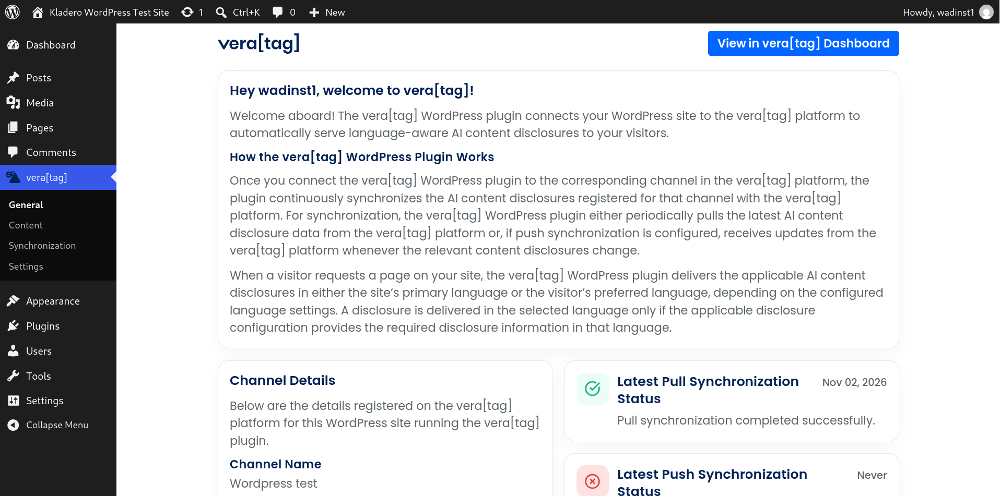
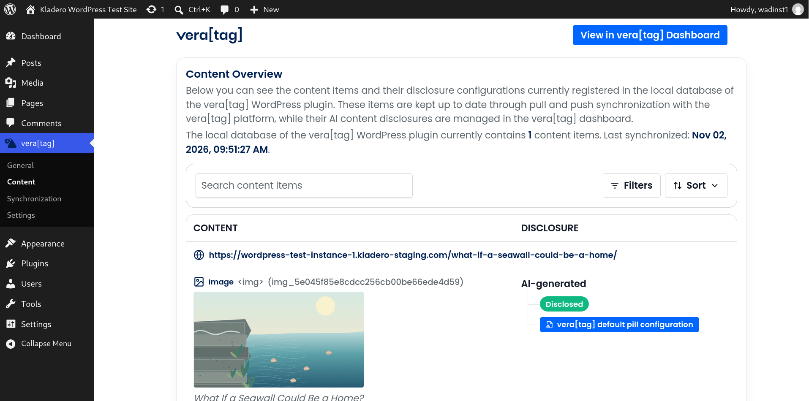
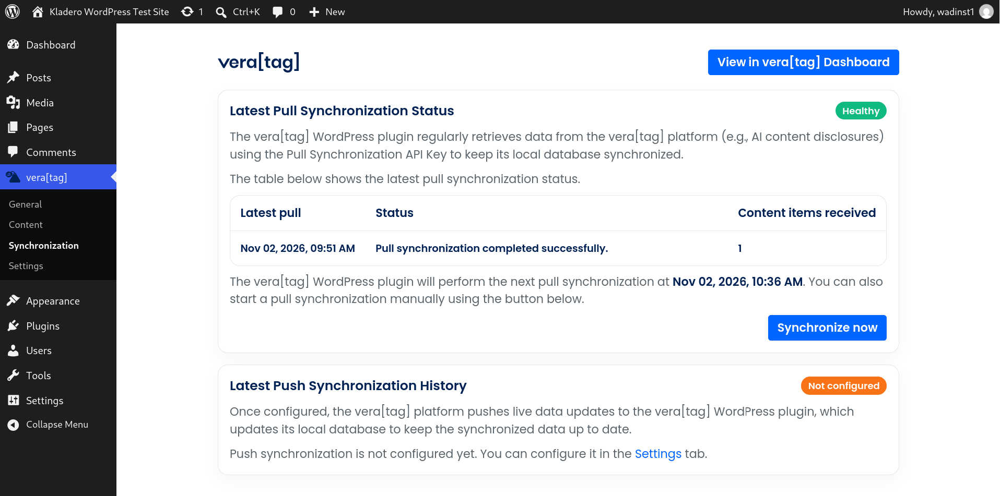
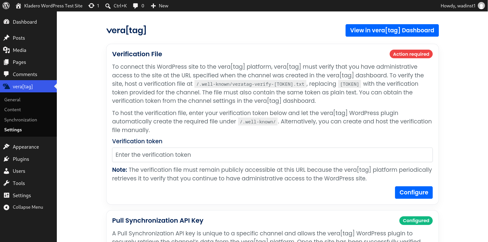
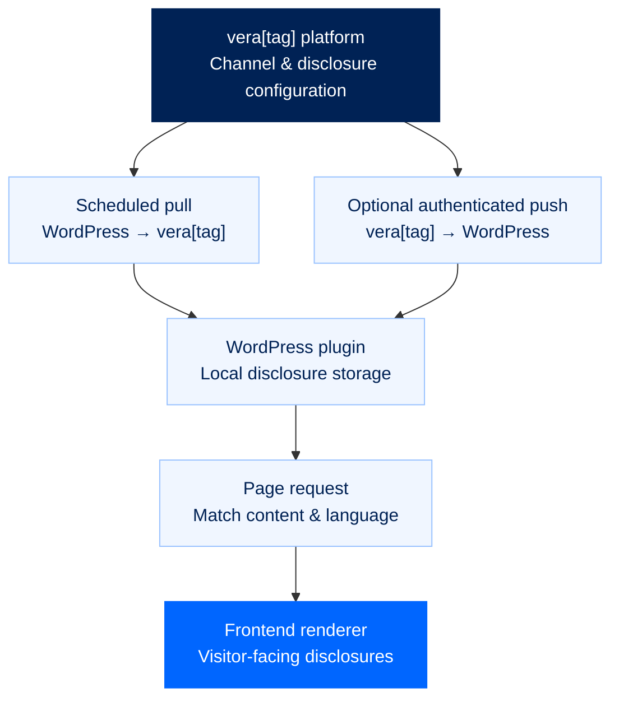

<div align="center">
  <a href="https://vera-tag.com">
    
  </a>

  <h1>AI content disclosures, seamlessly connected to WordPress.</h1>

  <p>
    The official <strong>vera[tag] WordPress integration</strong> by <strong>Kladero GmbH</strong>.<br>
    Synchronize disclosure data from vera[tag], manage your integration in WordPress,
    and deliver language-aware AI content disclosures to website visitors.
  </p>

  <p>
    <a href="https://vera-tag.com"><strong>Explore vera[tag]</strong></a>
    &nbsp;·&nbsp;
    <a href="#getting-started"><strong>Get started</strong></a>
    &nbsp;·&nbsp;
    <a href="#build-from-source"><strong>Build from source</strong></a>
    &nbsp;·&nbsp;
    <a href="#how-it-works"><strong>How it works</strong></a>
  </p>

  <p>
    
    
    
    
    
  </p>
</div>

![vera[tag] WordPress integration — product overview](docs/images/veratag-wordpress-banner.png)

> **Disclosure data belongs in one place.** Manage your AI content disclosures in the vera[tag] platform; let the WordPress integration take care of synchronization and delivery on your website.

---

## At a glance

| Capability | Description |
| :-- | :-- |
| **Centralized disclosure management** | Connect a WordPress site to its corresponding vera[tag] channel. |
| **Automatic synchronization** | Periodically fetch current disclosure data from the platform. |
| **Optional push updates** | Receive authenticated changes from vera[tag] without waiting for the next scheduled pull. |
| **Language-aware delivery** | Use the site's preferred language or visitors' preferred languages, according to the configured mode and available disclosure translations. |
| **Content visibility** | Review synchronized content and disclosure-related issues in the WordPress admin. |
| **Integrated administration** | Manage connection settings, verification, synchronization, and disclosure status directly in WordPress. |

### Explore the admin experience

<table>
  <tr>
    <td width="50%" valign="top">
      <br>
      <strong>01 — General</strong><br>
      <sub>Connection overview, channel information, and synchronization status.</sub>
    </td>
    <td width="50%" valign="top">
      <br>
      <strong>02 — Content</strong><br>
      <sub>Content overview, disclosure status, and render-script information.</sub>
    </td>
  </tr>
  <tr>
    <td width="50%" valign="top">
      <br>
      <strong>03 — Synchronization</strong><br>
      <sub>Latest pull and push activity, with status and diagnostics.</sub>
    </td>
    <td width="50%" valign="top">
      <br>
      <strong>04 — Settings</strong><br>
      <sub>API connection, domain verification, optional push, and language preferences.</sub>
    </td>
  </tr>
</table>

---

## Getting started

### Requirements

| For a WordPress installation | Requirement |
| :-- | :-- |
| **WordPress** | **6.5 or newer**, as declared by the plugin header |
| **PHP** | **8.3 or newer** |
| **vera[tag]** | A vera[tag] account, a corresponding channel, and an API key |
| **Channel verification** | Follow the domain-verification instructions in the vera[tag] platform |

> **Note:** Node.js is **not** required on a WordPress server. It is needed only if you want to build the installable plugin ZIP from this source repository.

### 1. Install the plugin

If you have a ready-to-install vera[tag] plugin ZIP (for example, from an official distribution), open your WordPress dashboard and navigate to:

**Plugins → Add New Plugin → Upload Plugin → Install Now → Activate**

**Cloned or downloaded this GitHub source instead?** This repository is not laid out as a directly installable WordPress plugin. First [build the release ZIP](#build-from-source), then upload the generated ZIP using the steps above.

### 2. Connect your vera[tag] channel

1. Open the **vera[tag]** menu in the WordPress admin.
2. Follow the connection instructions in the [vera[tag] platform](https://vera-tag.com) to obtain the API key for your channel.
3. Go to **vera[tag] → Settings** and save the API key.
4. Complete domain verification as instructed by the platform. The plugin provides a verification-file configuration section for this purpose.
5. Check **General** or **Synchronization** to confirm that the first pull synchronization succeeded.

### 3. Choose your synchronization setup

**Pull synchronization is the standard connection mechanism.** The plugin periodically checks the vera[tag] platform for updated disclosure data, and you can also start a pull manually from the admin interface.

For more immediate updates, you can **optionally configure push synchronization** in Settings. When enabled and configured, the platform can send authenticated updates to the WordPress REST endpoint exposed by the plugin. That endpoint needs to be reachable from the platform.

### 4. Configure disclosure language

Under **Settings → Visitor Disclosure Language**, choose how the plugin selects the disclosure language:

- **Site-preferred:** Use the WordPress site's primary language.
- **Visitor-preferred:** Consider the visitor's preferred language and the configured fallback.

A disclosure is served in a selected language only when the relevant disclosure configuration contains the necessary information in that language. If a synchronized content record is malformed or missing required identification fields, the plugin skips that record while still delivering valid disclosures on the same page.

### 5. Review the result

Use the **Content** page to review synchronized content and disclosure state. The plugin loads applicable disclosure data for the requested page and makes it available to its frontend rendering logic.

![Example of a vera[tag] disclosure displayed on a WordPress site](docs/images/frontend-disclosure.png)

---

## How it works

The WordPress plugin connects your website to the matching vera[tag] channel. Disclosure information is managed in the vera[tag] platform, synchronized into WordPress, and used to render the relevant disclosures for website visitors.



**Behind the scenes:**

1. **Connect** — An administrator configures the channel API key and domain verification.
2. **Synchronize** — A WordPress cron schedule periodically fetches disclosure data; an optional authenticated push endpoint accepts platform-originated changes.
3. **Store** — The PHP persistence layer maintains local disclosure and synchronization records in WordPress database tables.
4. **Resolve** — On a page request, the plugin selects applicable disclosure data and determines the language according to the configured mode.
5. **Render** — The plugin loads the required frontend rendering script and supplies the applicable disclosure data to the page.

For further implementation detail, inspect [`src/php/Features/`](src/php/Features/) and [`src/php/Persistence/`](src/php/Persistence/).

---

## Built for transparency

This repository contains the **readable PHP implementation**, the **React/TypeScript admin UI source**, the **public release builder**, and a **version-locked npm dependency graph**.

| What you can inspect | Where |
| :-- | :-- |
| WordPress bootstrap, hooks, and autoloading | [`src/php/Bootstrap/`](src/php/Bootstrap/) |
| Synchronization, frontend delivery, and REST bridges | [`src/php/Features/`](src/php/Features/) |
| Persistence and database schema | [`src/php/Persistence/`](src/php/Persistence/) |
| Backend HTTP integration | [`src/php/VeraTagBackend/`](src/php/VeraTagBackend/) |
| Settings and option models | [`src/php/Settings/`](src/php/Settings/) |
| React admin UI and styles | [`src/ui/admin/`](src/ui/admin/) |
| Public, standalone ZIP builder | [`scripts/build-zip-release.mjs`](scripts/build-zip-release.mjs) |
| Third-party dependencies and licenses | [`package-lock.json`](package-lock.json) · [`THIRD_PARTY_NOTICES.txt`](THIRD_PARTY_NOTICES.txt) |

### Security and service boundaries

- The plugin communicates with the configured vera[tag] backend using **HTTPS** via the WordPress HTTP API.
- WordPress admin REST operations use the standard authenticated WordPress admin context; the push receiver uses a separate credential check.
- The plugin can host a **publicly reachable verification file** so the platform can verify continued site control.
- The frontend rendering script is retrieved and synchronized by the plugin as part of serving disclosures.
- An active connection requires the external vera[tag] service. It is **not** a standalone disclosure-management platform.

> **Handling credentials:** Never put real API keys, push secrets, verification tokens, or personal information in screenshots, GitHub issues, pull requests, or example configuration files.

For precise request behavior and data handling, consult the relevant PHP service classes. Before deploying, also review the applicable vera[tag] service terms and privacy documentation provided by Kladero GmbH.

---

## Build from source

Want to verify the public source or create your own installable WordPress ZIP? The repository includes everything needed for the **public release build**.

### Prerequisites

- **Node.js 22.12.0 or newer**, with npm
- An internet connection for the initial npm dependency installation

No Composer installation is required for this public build, and the installed WordPress plugin does not need Node.js.

### Build commands

```bash
# Install the exact dependencies from package-lock.json
npm ci

# Optional: lint the React/TypeScript admin UI
npm run lint:ui

# Compile the admin UI and create the installable WordPress ZIP
npm run zip:release
```

**Output**

```text
dist/
└── veratag-release-<version>.zip
```

The command runs the TypeScript/Vite UI build and then the standalone ZIP packager at [`scripts/build-zip-release.mjs`](scripts/build-zip-release.mjs).

<details>
<summary><strong>What's inside the generated ZIP?</strong></summary>

```text
veratag/
├── veratag-wordpress-plugin.php   # WordPress plugin entry point
├── src/php/                       # PHP implementation
├── assets/                        # Compiled admin UI and runtime assets
├── LICENSE
├── TRADEMARKS.md
└── THIRD_PARTY_NOTICES.txt
```

The PHP entry point sits at the repository root and keeps that position in the plugin ZIP, so the source and installed layouts match. The release builder also takes the plugin version from `package.json` and stamps the plugin header.

</details>

<details>
<summary><strong>How reproducible is the release build?</strong></summary>

- `npm ci` installs dependency versions locked in `package-lock.json`.
- The Node.js ZIP writer sorts entries, normalizes text line endings, and uses fixed ZIP timestamps, so identical packaged inputs yield identical ZIP bytes.
- Vite output can still vary with the Node/npm version, operating system, or toolchain environment. Match the original build environment when comparing release hashes.
- The checked-in compiled admin assets are reference outputs; `npm run zip:release` rebuilds them from the included source.

</details>

### Repository map

```text
.
├── assets/                      # Static assets + compiled admin UI
├── src/
│   ├── php/                     # Plugin implementation (PHP, PSR-4 classes)
│   │   ├── Bootstrap/
│   │   ├── Features/
│   │   ├── Filesystem/
│   │   ├── Logging/
│   │   ├── Persistence/
│   │   ├── Settings/
│   │   └── VeraTagBackend/
│   └── ui/admin/                # React + TypeScript + Vite
├── scripts/
│   └── build-zip-release.mjs    # Standalone public release builder
├── package.json                # Build scripts and plugin version
├── package-lock.json           # Locked npm dependency graph
├── LICENSE
├── TRADEMARKS.md
└── THIRD_PARTY_NOTICES.txt
```

The PHP runtime uses its own PSR-4 autoloader. It does **not** require Composer on the WordPress host.

---

## FAQ

<details>
<summary><strong>Is a vera[tag] account required?</strong></summary>

Yes. The plugin connects a WordPress installation to a channel on the external vera[tag] platform. You need the relevant channel and API key to synchronize disclosures.

</details>

<details>
<summary><strong>Do I need to enable push synchronization?</strong></summary>

No. Pull synchronization runs independently. Push synchronization is an optional mechanism for receiving platform changes more directly.

</details>

<details>
<summary><strong>Can I install this GitHub source ZIP directly in WordPress?</strong></summary>

No. This is a **source repository** with its PHP entry point (`veratag-wordpress-plugin.php`) in the repository root. Run `npm ci` and `npm run zip:release`, then upload `dist/veratag-release-<version>.zip` to WordPress.

</details>

<details>
<summary><strong>Does my WordPress server need npm, Node.js, or Composer?</strong></summary>

No. Those are not runtime requirements for a site using the finished plugin. Node.js and npm are used only to build the release ZIP from source.

</details>

<details>
<summary><strong>What happens if my plugin version is no longer supported?</strong></summary>

The admin UI includes a compatibility check against the vera[tag] backend. When the backend reports an unsupported version, the plugin shows an update-required screen instead of opening the normal admin pages.

</details>

---

## Contributing and reporting issues

Source transparency is an important part of vera[tag]. You can inspect the implementation, reproduce the release build, and use this repository to discuss code-level issues or potential improvements.

For a useful report, include your WordPress and PHP versions, the vera[tag] plugin version, the affected admin page or feature, and steps to reproduce the problem. **Redact all credentials and personal data.**

**Security issues:** Please report suspected vulnerabilities privately to Kladero GmbH through the [official company website](https://kladero.com), rather than publicly disclosing exploit details in an issue.

## Licensing and trademarks

The WordPress plugin is published under the **GNU General Public License, version 2 or later**. See [`LICENSE`](LICENSE) for the complete license text.

Additional details:

- [`THIRD_PARTY_NOTICES.txt`](THIRD_PARTY_NOTICES.txt) lists relevant third-party components and their licenses.
- [`TRADEMARKS.md`](TRADEMARKS.md) explains the trademark and branding status of **vera[tag]** and **Kladero**.
- The plugin is an integration with the separately operated vera[tag] service. Publishing the plugin source does not mean that the service itself is part of this repository.

---

<div align="center">
  
  <p><strong>Content transparency, connected.</strong></p>
  <p>
    Developed and maintained by <a href="https://kladero.com"><strong>Kladero GmbH</strong></a>.<br>
    <a href="https://vera-tag.com">vera-tag.com</a>
  </p>
</div>
